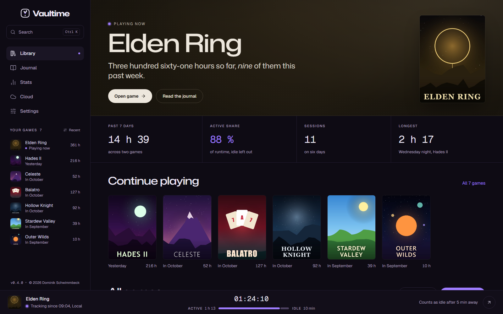
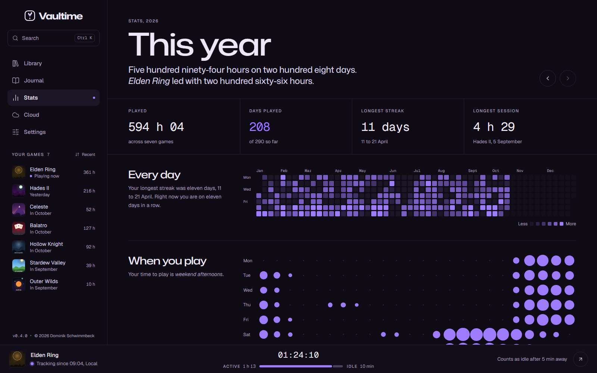

  <picture>
    <source media="(prefers-color-scheme: dark)" srcset="assets/vaultime-lockup-light.svg">
    
  </picture>

  <strong>Your game library and a playtime tracker you can trust.</strong> 
  Local-first. Windows and Linux. Free.

  
  
  
  

  

Vaultime notices when a game starts, from any launcher, and keeps the time it was open, the time you actually played and the time it sat idle apart. Your play reads like a journal, your library looks like a library, and everything stays on your PC.

  

## Features

- **Automatic tracking.** Add a game once, then start it however you like. No launcher integration needed.
- **Real playtime.** Runtime, active and idle time counted apart. Sleep never counts.
- **Finds your games.** Steam, Xbox, Epic, GOG, EA, Ubisoft, Battle.net, Riot, Heroic, Lutris and more, or any game by hand.
- **A journal of your play.** Every session written as a sentence, week by week.
- **Stats for every year.** A calendar of every day, the hours you play and your games month by month.
- **Your artwork, your look.** Covers from your own game folders, framed the way you like, and any accent color.
- **Honest trust labels.** Clock jumps, crashes and edits made outside Vaultime show up instead of hiding in a total.
- **Several PCs, one history.** Merge another PC's sessions from its backup.
- **Backups.** Daily local backups and optional encrypted cloud backup.

## Download

Get the latest version from [vaultime.codfishcloud.de](https://vaultime.codfishcloud.de/#download) or from the [releases on GitHub](https://github.com/vaultime/vaultime/releases/latest). Vaultime updates itself on one click.

| System | Package |
|---|---|
| Windows 10 and 11 | `Vaultime-setup.exe`, no admin rights needed |
| Debian, Ubuntu, Linux Mint, Pop!_OS | `.deb` |
| Fedora | `.rpm` |
| Arch, openSUSE and any other | `.AppImage` |

## Documentation

How playtime is counted, what the trust labels mean, how the ledger and merging several PCs work, backups, where your data lives and Linux notes are all in the **[documentation](https://vaultime.codfishcloud.de/docs/)**.

Vaultime has no analytics and no telemetry. See the [privacy policy](docs/legal/privacy-policy.md) and the [terms](docs/legal/terms-of-service.md).

## License

Vaultime is free software. The app is licensed under the [GNU General Public License](LICENSE), version 3 or later. The cloud server and its install tools are licensed under the [GNU Affero General Public License](apps/api/LICENSE), version 3 or later, so a changed server that others use online has to share its source as well.

The interface components from shadcn/ui are under the [MIT license](LICENSES/MIT.txt), and the fonts Mona Sans, Geist and Geist Mono under the SIL Open Font License 1.1.

The name Vaultime and the logo are not covered by these licenses. A modified version needs its own name and logo.

Contributions come with a short agreement, see [CONTRIBUTING.md](CONTRIBUTING.md).
