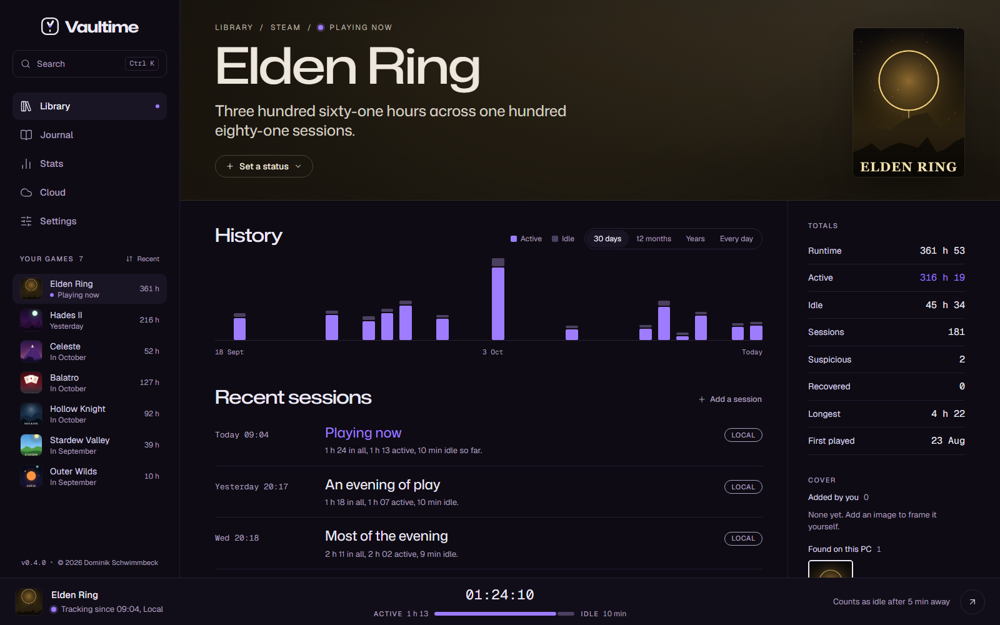

# Game pages and artwork

Every game has a page in the colors of its cover, with its history, its totals and the settings that decide how it is tracked.

## History

**History** charts the game's active and idle time over the last **30 days**, **12 months** or all **Years**. **Every day** shows a calendar of the year for this game alone, and clicking a day opens its week in the journal.

## Sessions and the event log

**Recent sessions** lists the game's latest sessions with their labels. Point at one to add a note or correct it, and use **Add a session** for play Vaultime did not see.

The **Event log** below lists every event in the records of the game's sessions: when tracking started, each time the times were saved, sleep left out, flags with their reason, the end, corrections and sessions added by hand. It is the place to look when a number seems off.

## Totals

The totals show the game's runtime, active and idle time, the number of sessions, how many were Suspicious or Recovered, the longest session and when you first played it. With playtime imported from Steam, **Before Vaultime** shows that part on its own.

## Status

**Set a status** marks a game as Backlog, Playing, Finished or Dropped. The status shows in the journal on the day you set it, and the library can filter by it.

## Cover art

### Where covers come from

Steam games get Steam's own cover from its library cache. For other games Vaultime looks through the install folder and the program's folder, three levels deep, and prefers files named like a cover, capsule, poster or banner over logos and screenshots. **Scan folder** looks again.

The **Cover** section groups images into **Added by you** and **Found on this PC**. Click one to make it the cover.

### Your own images

**Add image** takes a picture in PNG, JPEG, WebP, GIF, BMP, ICO, TIFF, TGA, QOI, the PNM family or SVG. You then frame it:

- Drag the image, use the mouse wheel or the slider to zoom.
- **Fill** covers the whole frame, **Fit whole image** shows all of it.
- Space next to a photo fills with a blurred, dimmed copy of it. A logo with a see-through background gets a plain backdrop in a fitting shade.
- **Use as cover** saves it. **Adjust** frames the current cover again later.

Vaultime keeps a copy of each image, so the original file can move or go away.

### Deleting images

The cross on an image deletes it after you confirm. The file it came from is never touched, and an image Vaultime found stays out of later scans.

### Colors from the cover

The page takes its tint from the cover, and so does the game's mark in the journal. Settings, Appearance can also use a game's art as the background picture of the whole app.

## Tracking

The **Tracking** section shows the program Vaultime watches and how the game is recognized, by its full path or by any game program in its install folder. It also holds:

Count only when no other game runs
: For launchers and game clients. Its time beside another game is set aside, see [How playtime is counted](counting.md#launchers-that-step-aside).

Edit
: Changes the title, the program and the install folder, for example after a game moved to another drive.

Hide
: Leaves the game out of the library while it is still tracked. See [Getting started](getting-started.md#hide-a-game).

Delete
: Removes the game and all of its sessions from this PC. Backups made earlier keep them, and the ledger notes the removal. Check *It is not a game* to make sure its program is never suggested or tracked again.
