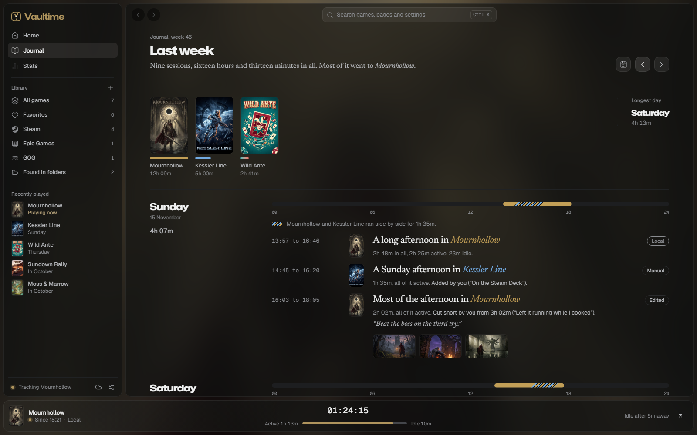
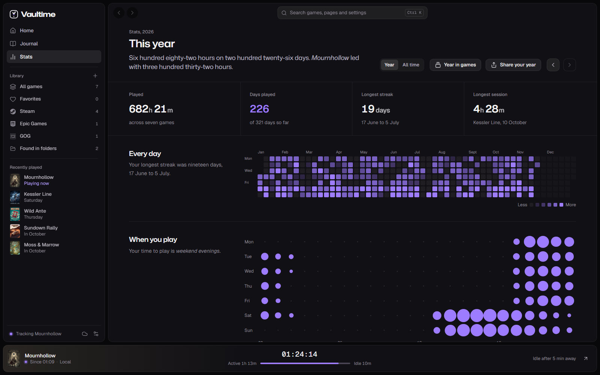

# The journal and stats

The journal tells your play week by week in plain sentences. The stats page looks at a whole year at once.

## The journal

The journal opens on this week. **Previous week** and **Next week** move through your history, and **Go to a day** jumps to any date and scrolls to it. A sentence at the top sums up the week and names the game that took most of it, when one did. Below it the week's games stand with their covers and hours, the most played first, each with a bar in its color, and its longest day, which jumps to that day.

Each day shows its total and a strip of 24 hours in the colors of the games you played. Below it every session is a sentence beside the game's cover, with its start and end time and how much of it was active and idle:

> A long evening in Elden Ring
>
> 3h 12m in all, 2h 58m active, 14m idle.

The wording changes from session to session but always stays the same for the same session. In a week of three finished sessions or more, the longest says so under its entry. Sessions note first looks, hour marks, returns after a long break, records and games left running. An hour mark is the session that took a game past ten, twenty-five, fifty, a hundred, two hundred fifty, five hundred or a thousand hours, and every thousand after, counting its playtime from before Vaultime as its total does. Status changes you set, like finishing a game, show up between the sessions and say how long you had played the game by then: its time up to that moment, counted as the stats count it, with any playtime from before Vaultime.

### Game colors

Every game gets a mark in the main color of its artwork, and its title takes that color in the sentences. Black, white or grey art gives a grey mark, and art with two strong colors shows both. When a game's color looks too much like another game of the same week or like your accent, it takes its second color, and only shifts when neither fits.

### Games side by side

When two games ran at the same time, the strip shows the shared stretch hatched in both colors and a sentence says which games ran together. The day total counts that time once, as the hours played on the stats page do.

### Past midnight

Time counts on the day it happened, so a session from 22:40 to 02:15 adds 1h 20m to the first day and 2h 15m to the second. Time the PC slept counts nowhere, so each day gets the time that really fell on it. It is still one session, and the journal shows it as one:

- The entry stays under the day it started, with the whole session's time, and its time reads *22:40 to Sun 02:15*. It adds how much counted after midnight and on which day.
- The bar runs out over the right edge of the first day's strip and back in at the left edge of the next.
- The next day shows no second entry, only a quiet line such as *Still in Elden Ring from Saturday night*, with how much of the whole counts on that day.
- Each part links to the other, also across weeks, and pointing at either marks both. Pointing at the bar shows each day's part and the whole.

A session that ran for more than a day reads the same way, with every day it touched.

## Notes

Point at a session and pick **Add a note** to keep a line about it, up to 280 characters. The note shows under the session in quotes.

## Correct a session

A game left running overnight should not count as a night of play. Point at the session in the journal or on the game's page and pick **Correct the time**.

Count it only until a time
: For a game you left running. Pick when you stopped playing. Exactly the active and idle time after that point comes out, read from the session's own record.

Take out all its time
: For a session that was no play at all.

Give a reason under **Why**. The session is then labeled Edited, unless it was Suspicious or Manual, which keep their label. Its old times and your reason stay in its log. A correction can only take time out, never add any or move the end later. Only the PC that recorded a session can correct it, see [Several PCs](several-pcs.md).

## Add play Vaultime did not see

Played on a Steam Deck or a PC without Vaultime? On the game's page, **Add a session** asks for the start, the length, where you played and, for Steam games, whether you played through Steam. A session added by hand is labeled Manual, counts as active time and can be up to 24 hours long.

## Stats

The stats page shows one year at a time, with **Previous year** and **Next year** to move, or **All time** for everything since your first session. At the top are the hours played, the days you played, your longest streak and your longest session.

Every day
: A calendar of the year with a square for each day, brighter the more you played. A day counts the time the journal shows for it, games side by side once. Point at a day to see what you played, and click it to read that day in the journal.

When you play
: Your week by hour, so you can see whether you are a weekday evening or a weekend afternoon player.

Games
: The eight games you played most that year, or of all time.

Month by month
: Each month's hours. Point at a month to see its games.

Year by year
: Only in All time, in place of the calendar and the months: each year's hours since your first session. Point at a year to see its games. Streaks there run across New Year.

Session lengths
: How your sessions split into quick looks, short, medium and long sessions and marathons.

Left running
: Games that often ran while you were away. Only shown when there are some.

### Year in games

**Year in games**, at the top of the stats page or in the command palette, tells a year in chapters, one card at a time: the year in numbers, your game of the year, your top five, the longest session, the week you played most, when in the day you play, the launchers your hours came from and the games you finished. A chapter with nothing to tell is left out. Space or the arrow keys move on, and **Share your year** on the page makes a picture of the year to post.

Like the stats page, it counts every PC whose sessions you merged, the time each launcher's copy of a game recorded and play while offline. Hidden games count in the hours but never show. Vaultime works it out on your PC from your journal and uploads nothing.

### Share your year

**Share your year**, at the top of the stats page or in the command palette, makes a picture of the year to post. It shows your hours of active play, the days you played, your longest streak, the busiest month, the year calendar, your most played games with their covers and colors, and a line about the year.

Format
: **Wide** at 1200 by 675 for X, Discord and Mastodon, **Square** at 1080 by 1080 for feeds, **Story** at 1080 by 1920.

On the card
: **Game titles and covers**, **Calendar of the year** and **Name of this PC** can each be switched off. Without titles the card shows how many games you played and how the time split. Hidden games never appear.

Games on the card
: The games the card names, each with an eye to leave it off. The next game moves up in its place, and a game left off still counts in the hours.

Look
: Dark or light, always in your ground and accent.

**Save as PNG** saves the picture, and **Copy image** puts it on the clipboard to paste into a post, where your system allows it. Vaultime draws the picture on your PC and uploads nothing.

### What the stats count

Stats are worked out in quarter hours from each session's record, so time lands on the day and hour it happened. Time a launcher [set aside](counting.md#launchers-that-step-aside) counts nowhere, a session whose time you took out counts nowhere, and playtime imported from Steam stays out because Steam does not say when you played.
