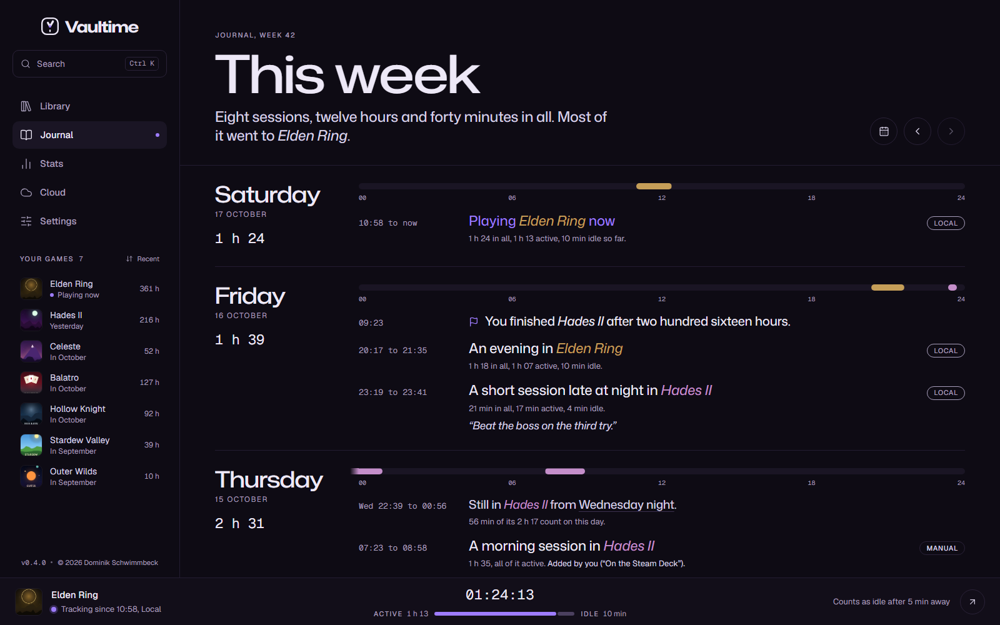

# The journal and stats

The journal tells your play week by week in plain sentences. The stats page looks at a whole year at once.

## The journal

The journal opens on this week. **Previous week** and **Next week** move through your history, and **Go to a day** jumps to any date. A sentence at the top sums up the week and names the game it mostly went to.

Each day shows its total and a strip of 24 hours in the colors of the games you played. Below it every session is a sentence, with its start and end time and how much of it was active and idle:

> A long evening in Elden Ring
>
> 3 h 12 in all, 2 h 58 active, 14 min idle.

The wording changes from session to session but always stays the same for the same session. Sessions note first looks, returns after a long break, records and games left running. Status changes you set, like finishing a game, show up between the sessions.

### Game colors

Every game gets a mark in the main color of its artwork, and its title takes that color in the sentences. Black, white or grey art gives a grey mark, and art with two strong colors shows both. When a game's color looks too much like another game of the same week or like your accent, it takes its second color, and only shifts when neither fits.

### Games side by side

When two games ran at the same time, the strip shows the shared stretch hatched in both colors and a sentence says which games ran together. The day total counts that time once.

## Notes

Point at a session and pick **Add a note** to keep a line about it, up to 280 characters. The note shows under the session in quotes.

## Correct a session

A game left running overnight should not count as a night of play. Point at the session in the journal or on the game's page and pick **Correct the time**.

Count it only until a time
: For a game you left running. Pick when you stopped playing. Exactly the active and idle time after that point comes out, read from the session's own record.

Take out all its time
: For a session that was no play at all.

Give a reason under **Why**. The session is then labeled Edited, and its old times and your reason stay in its log. A correction can only take time out, never add any or move the end later. Only the PC that recorded a session can correct it, see [Several PCs](several-pcs.md).

## Add play Vaultime did not see

Played on a Steam Deck or a PC without Vaultime? On the game's page, **Add a session** asks for the start, the length, where you played and, for Steam games, whether you played through Steam. A session added by hand is labeled Manual, counts as active time and can be up to 24 hours long.

## Stats

The stats page shows one year at a time, with **Previous year** and **Next year** to move. At the top are the hours played, the days you played, your longest streak and your longest session.

Every day
: A calendar of the year with a square for each day. Point at a day to see what you played, and click it to read its week in the journal.

When you play
: Your week by hour, so you can see whether you are a weekday evening or a weekend afternoon player.

Games
: The eight games you played most that year.

Month by month
: Each month's hours. Point at a month to see its games.

Session lengths
: How your sessions split into quick looks, short, medium and long sessions and marathons.

Left running
: Games that often ran while you were away. Only shown when there are some.

### What the stats count

Stats are worked out in quarter hours from each session's record, so time lands on the day and hour it happened. Time a launcher [set aside](counting.md#launchers-that-step-aside) counts nowhere, a session whose time you took out counts nowhere, and playtime imported from Steam stays out because Steam does not say when you played.
