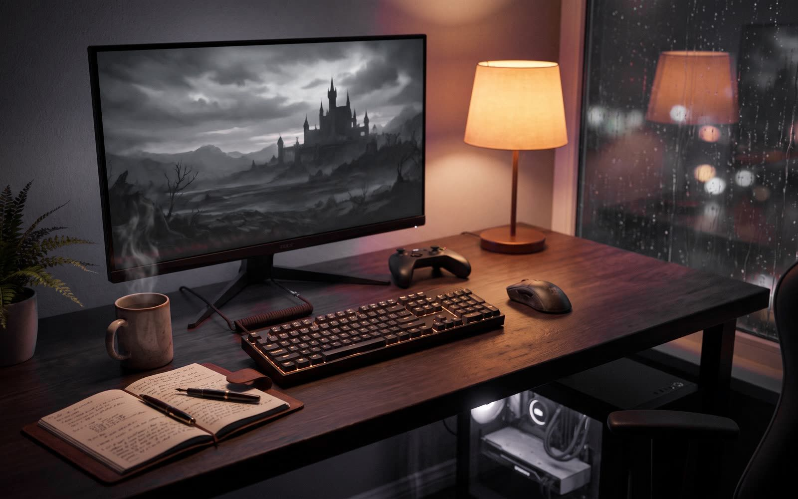

# How to see all your playtime in one place

Every launcher counts only its own games, and not every launcher shows a number at all. To see your hours across all of them, you need one app on your PC that notices every game you start, whichever launcher started it.

## Why your hours are spread out

- A launcher counts a game only while it runs from that launcher. A game you own in two launchers has two counts that never meet.
- Most launchers keep a total and the day you last played, not a history of your days.
- Games you installed yourself, from a folder, a mod pack or an old disc, are counted nowhere.

## Count every game with Vaultime

Vaultime is a free app for Windows and Linux that watches which game runs and counts it, wherever it came from.

1. [Download Vaultime](/#download) and install it. You need no account.
2. Pick **Discover games**. Vaultime reads what Steam, the Xbox app, Epic, GOG, EA, Ubisoft Connect, Battle.net, Riot and other launchers installed and looks through the usual game folders. You check the games you want, and you can add any game by hand.
3. Play the way you always do. You start games from their launchers, and Vaultime notices them on its own.
4. For the hours from before, pick Settings, Earlier playtime, **Import from Steam**. Vaultime reads how long Steam says you played each Steam game and counts nothing twice.

## What you see

- Every game in one library with its runtime, its active time and its idle time. Active time is the time you actually played, idle time is the rest. See [How playtime is counted](counting.md).
- A journal of your days, with every session written as a sentence and a 24 hour strip for each day.
- A page for each launcher with its own hours, so you still see what came from Steam and what from GOG.
- A game you own in two launchers can count as one game, while each launcher keeps the time played through its copy.
- Your year told in chapters in **Year in games**, from your game of the year to the games you finished.

## What it cannot see

- Play on a console, a phone or another device without Vaultime. You can add such a session by hand, and it is labeled Manual.
- Hours from before you installed it, except the totals Steam reports.
- Your launcher accounts. Vaultime never signs in to a launcher and reads only what is on your PC.

## Launcher by launcher

How each launcher shows your playtime and what it counts:

- [Steam](steam-playtime.md)
- [The Steam Deck](steam-deck-playtime.md)
- [Epic Games](epic-games-playtime.md)
- [GOG Galaxy](gog-galaxy-playtime.md)
- [The Xbox app](xbox-app-playtime.md)
- [The EA app](ea-app-playtime.md)
- [Ubisoft Connect](ubisoft-connect-playtime.md)
- [Battle.net](battle-net-playtime.md)
- [League of Legends and VALORANT](riot-games-playtime.md)
- [Heroic and Lutris on Linux](linux-playtime.md)

## Your data stays on your PC

Vaultime keeps everything in one folder on your PC. It goes online only to look for updates and, if you use it, for cloud backup. See [Your data and privacy](data-and-privacy.md).
